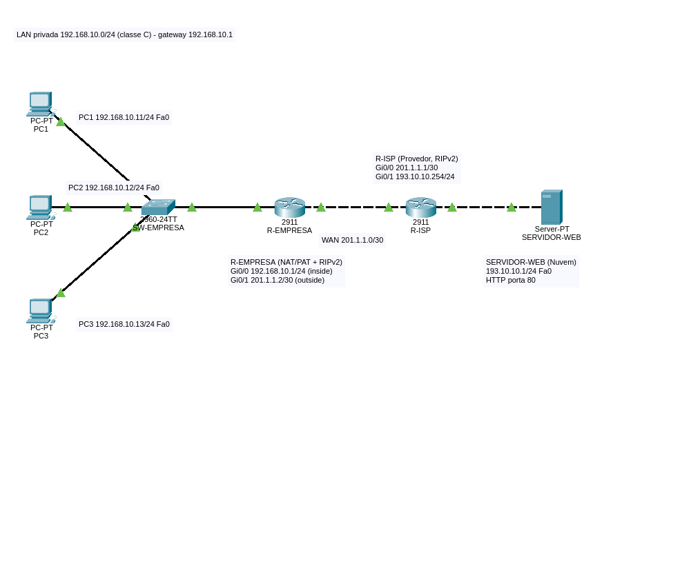

# Rede local privada com NAT e RIP — Cisco Packet Tracer

📄 **Relatório com as respostas (itens a–d):** [`relatorio.pdf`](relatorio.pdf) · [`relatorio.docx`](relatorio.docx) (Word)
🖧 **Arquivo do Packet Tracer:** [`topologia_nat_rip.pkt`](topologia_nat_rip.pkt)  (cabeçalho marcado como versão 8.2.2, para abrir no PT 8.2.2; se der erro, veja [MONTAR-NO-PT-8.md](MONTAR-NO-PT-8.md))

## Resumo
- **LAN privada:** 192.168.10.0/24 (classe C): PC1 .11, PC2 .12, PC3 .13, gateway .1
- **R-EMPRESA (2911):** Gi0/0 192.168.10.1/24 (NAT inside) · Gi0/1 201.1.1.2/30 (NAT outside)
- **R-ISP / provedor (2911):** Gi0/0 201.1.1.1/30 · Gi0/1 193.10.10.254/24
- **Servidor Web na nuvem:** 193.10.10.1/24, HTTP porta 80
- **Roteamento:** RIPv2, `no auto-summary` (a LAN privada não é anunciada ao provedor)
- **NAT:** PAT/overload no IP 201.1.1.2

## Conteúdo
| Arquivo | O que é |
|---|---|
| `relatorio.pdf` | Documento único com os itens a, b, c e d |
| `relatorio.docx` | O mesmo relatório em Word (editável) |
| `topologia_nat_rip.pkt` | Topologia configurada, versão 8.2.2 no cabeçalho |
| `topologia_nat_rip_pt9-original.pkt` | Arquivo original salvo pelo PT 9.0.1 |
| `cli/` | Saídas reais da CLI: configuração, `show ip route`, `show ip protocols`, `show ip nat translations` |
| `prints/topologia.png` | Captura do canvas com IPs e interfaces |
| `plan.json` | Descrição estruturada da topologia |
| `configs-para-colar/` | Configs dos roteadores prontas para colar na CLI |
| [`MONTAR-NO-PT-8.md`](MONTAR-NO-PT-8.md) | Plano B: remontar à mão no PT 8.x |
